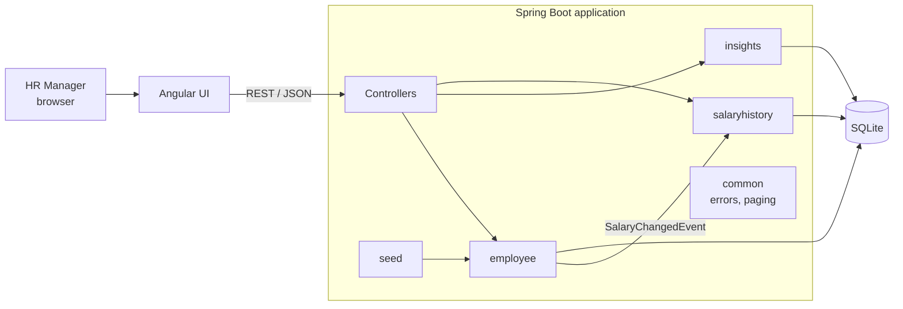
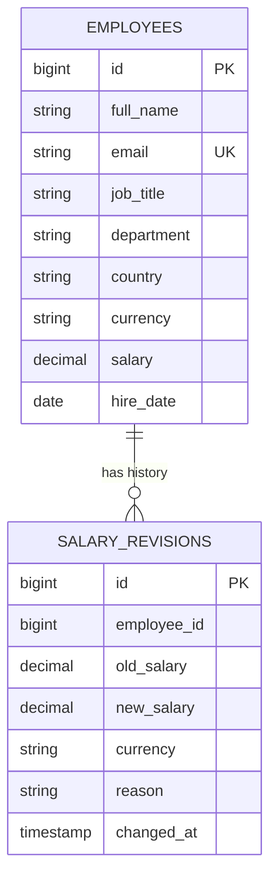

# Design

## Architecture at a glance

A **modular monolith**: one Spring Boot application, organised by feature module, backed by SQLite. The Angular UI is built into the same application, so the whole system deploys as a single unit with one URL.



## Modules

| Package | Responsibility |
|---|---|
| `employee` | Employee entity, CRUD, search / filter / pagination. Publishes `SalaryChangedEvent` when a salary changes. |
| `insights` | Read-only salary statistics per country and per job title. Separate repository with aggregation queries only. |
| `salaryhistory` | Listens for `SalaryChangedEvent`, stores salary revisions, serves an employee's salary history. |
| `seed` | Generates 10,000 realistic employees and loads them on startup when the database is empty. |
| `common` | Cross-cutting pieces: `PageResponse`, `ApiError`, global exception handler. |

Each module has its own controller, service and repository. Modules talk through services or events, never by reaching into each other's tables.

**Dependency direction:** `salaryhistory → employee` (one way). The employee module does not know salary history exists; it only publishes an event.

## Data model



**Indexes**
- `employees(country)` – filter and group by country
- `employees(country, job_title)` – job-title breakdown within a country
- `salary_revisions(employee_id)` – load one employee's history

`salary_revisions.employee_id` deliberately has **no foreign key**, so the audit trail survives if an employee is deleted.

## REST API

| Method | Endpoint | Purpose | Success | Errors |
|---|---|---|---|---|
| GET | `/api/employees?name=&country=&jobTitle=&page=&size=&sortBy=&direction=` | Search, filter, sort, paginate | 200 | 400 unknown sort field |
| GET | `/api/employees/{id}` | One employee | 200 | 404 |
| POST | `/api/employees` | Create | 201 + `Location` | 400 validation, 409 duplicate email |
| PUT | `/api/employees/{id}` | Update (optional `salaryChangeReason`) | 200 | 400, 404, 409 |
| DELETE | `/api/employees/{id}` | Delete | 204 | 404 |
| GET | `/api/employees/{id}/salary-history` | Salary revisions, newest first | 200 | 404 |
| GET | `/api/insights/countries` | Headcount, min / max / avg salary per country | 200 | – |
| GET | `/api/insights/countries/{country}` | Country summary + breakdown by job title | 200 | 404 |
| GET | `/api/insights/job-titles` | Distinct job titles (for UI filters) | 200 | – |

Every error returns the same shape:
```json
{ "status": 400, "message": "Validation failed", "fieldErrors": { "salary": "must be greater than 0" } }
```

## Key decisions

| Decision | Why | Trade-off |
|---|---|---|
| **Modular monolith, not microservices** | One HR persona, 10k rows, tightly related data. Microservices would add network calls, distributed data and deployment overhead with no benefit. | Modules cannot be scaled or deployed independently – acceptable at this size, and the module boundaries keep a later split possible. |
| **SQLite** | Suggested by the brief; zero setup; no separate database server to host. | One writer at a time (connection pool set to 1). Switching to PostgreSQL is a config change because the code uses JPA. |
| **Salaries stay in local currency; insights are per country** | Averaging INR and USD together is meaningless; currency conversion needs a live FX source. | No cross-country salary comparison in this version. |
| **Aggregation in SQL (`GROUP BY`)** | The database returns a few summary rows instead of 10,000 employees. | Report logic lives in JPQL, not Java. |
| **Request / response DTOs instead of exposing entities** | API shape stays stable when the schema changes; clients cannot set `id`. | A few extra small classes. |
| **Event for salary changes** (`SalaryChangedEvent`) | Employee module stays unaware of history; approval workflow or notifications become new listeners, not edits to `EmployeeService`. | Slightly less obvious flow than a direct call – documented here. |
| **Synchronous listener in the same transaction** | Salary change and its history entry are saved together or not at all. | A failing listener blocks the update – correct for an audit record. |
| **Page size capped at 100, sort-field whitelist** | Protects the API from "give me all 10k rows" and from errors on unknown fields. | Clients must page through results. |
| **`ddl-auto: update`** | Fast iteration for a prototype. | Production would use versioned migrations (Flyway). |
| **Fixed random seed for demo data** | Same 10,000 employees on every fresh start – reproducible demos and tests. | Not random across runs – intended. |

## Testing strategy

| Layer | Test type | What it proves |
|---|---|---|
| Data generator | Plain JUnit (no Spring) | Unique emails, correct currency per country, deterministic output |
| Services | `@DataJpaTest` with in-memory SQLite | Real queries: filters, paging, duplicate emails, aggregation maths, salary history |
| Controllers | `@WebMvcTest` with mocked service | URLs, status codes, validation errors, JSON shape |
| Performance | `@DataJpaTest` with 10,000 employees | Insight queries stay under 500 ms (fails the build otherwise) |

Built test-first: each feature has a `test:` commit followed by a `feat:` commit in the history.

## Path to scale (and to microservices)

| Trigger | Change |
|---|---|
| Multiple concurrent HR users | PostgreSQL; several stateless app instances behind a load balancer |
| Heavy reporting | Cache insights, evicted on `SalaryChangedEvent`, or maintain summary tables |
| Separate teams / products (e.g. payroll) | Extract a module into its own service. `insights` and `salaryhistory` are the first candidates: they already depend only on events and read models. The in-process `SalaryChangedEvent` would become a message on a broker such as RabbitMQ. |
